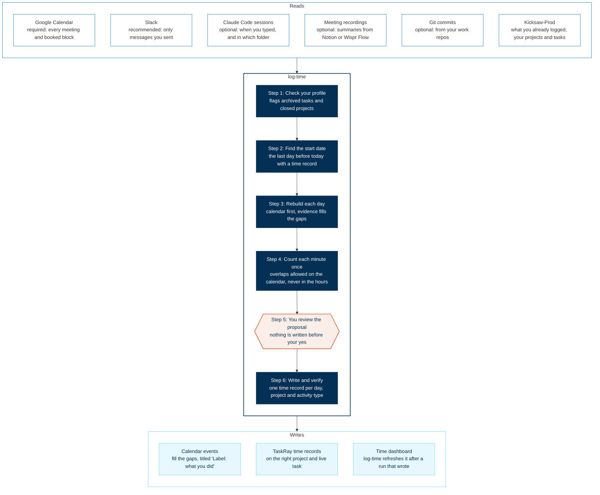

# log-time and time-report skills

Two skills for Claude Code and Codex that log your TaskRay time from what you actually did. They share one profile, and nothing is written until you approve it.

**To install, agents included:** download https://raw.githubusercontent.com/bbold-bb/kicksaw-time-skills/main/SETUP.md with your shell, read all of it, and follow it. Don't clone the repo or build zips; the [quick start](#quick-start) is the whole install.

| Skill | What it does | Writes? |
| --- | --- | --- |
| `log-time` | Finds the days you haven't logged, rebuilds the work from your calendar, Slack and work evidence, and creates calendar events and TaskRay time records in Kicksaw-Prod after you approve a proposal | Yes, after your approval |
| `time-report` | Shows what is already logged by project and activity type, your pace against the week or month, and an HTML dashboard | No, read-only |

## How it works

Say "log my time" (`/log-time` in Claude Code, `$log-time` in Codex). By default a run covers every day from your last logged day through today; name a date or range to change that.



What it will and won't do:

- **Never invents work.** A gap with no evidence is listed as unaccounted, and you're asked about it.
- **Adds, doesn't edit.** Past days get a second record. Only a record created today is merged in place.
- **Notes read like yours.** Time records and calendar events never mention Claude, Codex, AI, sessions or how they were built.
- **Only writes where it should.** Kicksaw-Prod time records and your calendar. Every other org, repo and Slack stays read-only.

`time-report` is the read-only half. It reads the same profile and the time records already in Kicksaw-Prod, then reports hours by project and activity type against a weekly baseline with holidays removed. Ask "am I on pace this week?" or "show me my month as a dashboard".

For the same picture as a designed page, plus setup steps, see [docs/time-skills-guide.html](docs/time-skills-guide.html). GitHub shows HTML files as source, so use **Download raw file** and open it in a browser.

## What's in the repo

The skill folders are `skills/log-time/` and `skills/time-report/`. Each follows the standard Agent Skills layout: a `SKILL.md` with frontmatter, a `reference/` folder, and a `profile.example.json` template. On first run it walks you through setup, checks every answer against the org, and saves your profile to `~/.claude/kicksaw-time/profile.json`. It re-asks about your projects every 30 days, or sooner when the org disagrees with the profile.

## Prerequisites

- Claude desktop (the Code tab) or Codex, on a Mac or on Windows. The quick start installs the rest: the skills, the Salesforce CLI (`sf`) signed in to the Kicksaw org (default alias `Kicksaw-Prod`), and Python for the report
- A Google Calendar connector on your Kicksaw account, connected in whichever Claude surface you use
- Recommended: a Slack connector on the Kicksaw workspace. The skill reads the messages you sent as evidence and never posts. Without it, setup saves Slack as off and the skill says so on every run
- Optional: a Notion or Wispr Flow connector, if your meetings are recorded there. Summaries make notes specific and never change hours
- Optional: Claude Code session transcripts and local git repos, which are the evidence for gap reconstruction. Without them the skill can still fill gaps you describe, but it will not reconstruct anything on its own

## Version

For the team, the *What's new* tab of the shared guide lists recent changes in plain words, including which ones came from team feedback. This repo's [CHANGELOG.md](CHANGELOG.md) has the full detail.

Both skills share one version, recorded in the `version:` line of each `SKILL.md` and listed in [CHANGELOG.md](CHANGELOG.md). Once you have installed, read the version you are on with:

```
head -3 ~/.claude/skills/log-time/SKILL.md
```

If that is behind the latest in the changelog, update with `npx skills update`. If you installed with `install.sh` or by copying the folders yourself, the installed copy is a snapshot instead, so `git pull` alone changes nothing: pull, then run `./install.sh` again.

## Install

### Quick start

Paste this line into Claude desktop's Code tab or into Codex:

```
Download https://raw.githubusercontent.com/bbold-bb/kicksaw-time-skills/main/SETUP.md with your shell, read all of it, and follow it to set up the Kicksaw time skills.
```

It works on a Mac or on Windows. The agent checks what's already set up, asks once before installing anything, installs the skills, the Salesforce CLI and Python, opens your browser to sign in to the Kicksaw org, tells you where to connect Calendar and Slack, and then starts log-time's setup. Paste the same line again any time to update or repair a setup. The steps it follows are in [SETUP.md](SETUP.md).

### For technical users

The commands below install by hand. The two skills install together. `time-report` reads the profile `log-time` creates, so `--skill '*'` in the commands below is deliberate. These need the Salesforce CLI signed in already (`sf org login web -a Kicksaw-Prod --instance-url https://kicksaw.my.salesforce.com`).

#### Claude Code, global

```
npx skills add bbold-bb/kicksaw-time-skills --agent claude-code --global --skill '*'
```

It installs both skills to `~/.claude/skills/`.

**Keep `--agent claude-code`.** The agent is named `claude-code`, not `claude`: passing `claude` installs nothing and prints a list of valid names. Leaving `--agent` off entirely is worse. A non-interactive run then installs into every agent directory the CLI knows, which is over fifty folders in your home directory.

Your profile lives at `~/.claude/kicksaw-time/profile.json`, outside the skill folders, so installing and updating never touch it.

#### Claude Code, one project

The same command without `--global` installs into the current project instead:

```
npx skills add bbold-bb/kicksaw-time-skills --agent claude-code --skill '*'
```

The profile stays at `~/.claude/kicksaw-time/profile.json`, so there is nothing to gitignore and one profile serves every project.

#### Updating

```
npx skills update
```

The CLI records what you installed in `skills-lock.json` and updates from the same source.

**Do not copy the folders by hand to update.** `cp -R skills/log-time ~/.claude/skills/log-time` onto an existing folder nests it as `~/.claude/skills/log-time/log-time` rather than replacing it. Use `npx skills update`, or `./install.sh`, which replaces the folder cleanly.

#### Without npm

`install.sh` does the same job with no dependency on npm, and works offline. It lives in this repo rather than inside the skills, so `npx skills add` does not deliver it; clone the repo once:

```
git clone https://github.com/bbold-bb/kicksaw-time-skills.git
cd kicksaw-time-skills
./install.sh
```

To pick up a later release, run `git pull` in that clone and `./install.sh` again. `./install.sh --check` reports whether your install is behind. `--project PATH` installs into one project.

It is also the only path that migrates a profile from 1.1.0 or earlier, where the profile lived inside the skill folder. If you installed before 1.2.0, run it once; it moves the profile to `~/.claude/kicksaw-time/profile.json` and tells you it did.

#### Cowork (Claude desktop app)

Cowork has no CLI installer, so start by cloning the repo as under **Without npm** above. Zip the `skills/log-time` folder so the folder itself is the root of the archive, then in Cowork open Customize, click the plus button, choose the Skills tab, and upload the zip. Repeat for `skills/time-report`. Run `/log-time` first so the profile exists at `~/.claude/kicksaw-time/profile.json`; the report script finds it there regardless of where Cowork puts the skills. Cowork needs the same `sf` CLI login on the machine to read and write the org; if it cannot reach the CLI, the skill will stop at the proposal and tell you. This path is untested.

#### Codex

Codex reads skills from `~/.agents/skills` (or `.agents/skills` in a project) and repo instructions from `AGENTS.md`. Both install paths support it:

```
npx skills add bbold-bb/kicksaw-time-skills --agent codex --global --skill '*'
```

or, from a clone:

```
./install.sh --codex
```

`./install.sh --codex --check` reports whether the Codex install is behind, and `--project PATH` installs into `PATH/.agents/skills`. Then start Codex and say "log my time" or `$log-time`; `/skills` lists what is installed.

Codex uses the same profile at `~/.claude/kicksaw-time/profile.json`, so if you already set up in Claude Code there is nothing to redo. What differs:

- **Questions come as numbered lists** instead of click-through pop-ups. Answer with the numbers.
- **Calendar and Slack** need to be connected in Codex itself, as connectors or MCP servers in `~/.codex/config.toml`. The `sf` CLI login is shared, so the org works as is.
- **Evidence:** the skill reads Claude Code session transcripts in `~/.claude/projects` if you have them. It does not read Codex's own session history yet, so Codex-only work is rebuilt from git commits, Slack and the calendar.
- **Windows:** Codex on Windows is untested.
- **Dashboards:** the local HTML dashboard works. The published claude.ai dashboard is Claude-only; Codex skips that refresh and says so.
- Depending on your Codex sandbox settings, Codex may ask before running `sf` commands or saving the profile, since both reach outside the project folder.

#### Command name collisions

If you already have `/log-time` or `/time-report` commands in `~/.claude/commands`, remove them first or they will collide on the name. This applies to every install path above.

## First run

The quick start begins this for you. Otherwise, say `/log-time` (or just "log my time"). With no profile the skill runs setup, and setup is mostly clicks. It reads what it can from the org and your connectors: your user and timezone, and the projects you are staffed on in Resource Hero or logged to in the last 90 days. You tick the ones to log against, and each project's live time-entry task is found for you. Labels default to the client name. It offers the folders that hold your repos and the Slack channels that match each project, and you tick those too (every channel is resolved live before it is saved, and the skill never posts to Slack). It asks how you work and where your meetings are recorded, and whether you color-code projects on your calendar and whether you use Google Tasks. Last, you pick your work hours and timezone, and save. Folders and channels it can't place are asked about later, on the first run that finds work in them. Review the saved profile it shows you; every field can be edited by hand afterwards.

## How a run goes

1. Fill your calendar gaps first with anything it can't see, like a phone call or a Google Task.
2. Say "log my time" with no date. It starts from your last record.
3. Approve the calendar events. Answer the questions it lists, then let it write your calendar.
4. Check your calendar, fix anything that looks off, and tell it what changed.
5. Approve the time records. They're written exactly as shown, and the skill only changes a record on the day it was written.
6. Talk through the unaccounted time, and it adds what you tell it.
7. Your dashboard opens in your browser, with a link to My Hours - Dashboard 2.0 in Salesforce, which shows the same records.

## Files

| File | What it is |
| --- | --- |
| `SETUP.md` | The guided setup the quick start line points to. Written for the agent, with a Mac and a Windows form of every step |
| `AGENTS.md` | Repo instructions for Codex and other coding agents: layout, release rules, what never gets committed |
| `docs/time-skills-guide.html` | One-page visual guide: how a run works, prerequisites, install for Claude Code and Codex, first-run setup, troubleshooting |
| `skills/log-time/SKILL.md` | The process. Read this to understand what the skill will and will not do |
| `skills/log-time/reference/taskray.md` | Org-wide record types, picklists, queries, and the insert payload |
| `skills/log-time/reference/meetings.md` | Which meeting recorders the skill reads, and how |
| `skills/log-time/profile.example.json` | Shape of the per-user profile that setup writes |
| `~/.claude/kicksaw-time/profile.json` | Your profile. Created by setup, never shipped, and outside the skill folders so updates cannot replace it. Also holds `holidays` and `baseline_hours_per_week`, which both skills use |
| `skills/time-report/SKILL.md` | How to run and read the report |
| `skills/time-report/time_report.py` | The report script. Reads the shared profile, queries the org, prints the table and the pace line |
| `skills/time-report/dashboard_template.html` | The HTML page `time_report.py --dashboard` fills in: totals and a week-by-week allocation view |
